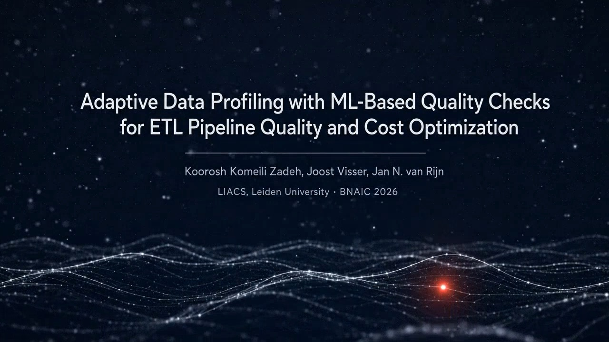

# Adaptive Data Profiling for ETL Pipelines

**Learned, per-column data quality checks at the point where data enters the pipeline.**

[](https://kooroshkz.github.io/adaptive-data-profiling-etl/)
[](https://pypi.org/project/adaptive-profiler/)
[](LICENSE)

Code and experiments for the BNAIC 2026 paper
**"Adaptive Data Profiling with ML-Based Quality Checks for ETL Pipeline Quality and Cost Optimization"**
by Koorosh Komeili Zadeh, Joost Visser and Jan N. van Rijn (LIACS, Leiden University).

[Project page](https://kooroshkz.github.io/adaptive-data-profiling-etl/) · [Video (4:50)](https://kooroshkz.com/files/content/AdaptiveProfiler/bnaic2026_video.mp4) · [PyPI package](https://pypi.org/project/adaptive-profiler/)

[](https://kooroshkz.github.io/adaptive-data-profiling-etl/)

## The idea

Rule-based checks catch type, null and range violations. They do not catch values that are valid but far from the historical norm, such as a 0 °C reading that passes a `[-10, 60]` rule in a week when every recent reading was above 25 °C.

The **Adaptive Profiler** adds a second, learned check right after the rules, inside the Extract stage:

```
Source  →  [ Rule check  →  Learned check ]  →  Transform  →  Load
                      Extract
```

- For every configured column of every source, an **Optuna** search (25 trials, TPE) picks a **PyOD** detector (Isolation Forest, LOF, ECOD, HBOS, COPOD) and its hyperparameters.
- The search uses a **stability-based, unsupervised objective**. No labels are used for training or selection.
- The fitted model scores each incoming batch. The output has one row per (timestamp, column) with the anomaly score, a flag, and any rule violations. Failures are reported, not raised, so the pipeline keeps running.
- Detection runs at ingestion, before values are folded into aggregates (shift left).

## Key results

| Finding | Result |
|:-|:-|
| **1. The column decides** | Tight, predictable columns are detected reliably: surface pressure and soil moisture reach F2 > 0.9. Skewed or noisy columns (precipitation, temperature in variable climates) are not. |
| | Amsterdam temperature: the rule admits all 74 injected anomalies, the learned check catches 53 (recall 71.6%). |
| | Electricity demand (overridden): F2 0.929 (INDO) and 0.902 (ITSDO). |
| **2. Cost is predictable** | Training time follows `T(n, m, k) = α · n^β · m^δ · k^γ`, fitted on about 90 runs (R² ≈ 0.86). |
| | Row exponent β ranges from 0.307 (Isolation Forest) to 1.175 (LOF). |
| | Projection error: 8.9% when calibrated on 25% of the data, 0.5% from 75%. |
| **3. Classical beats neural here** | Under the same search and budget, classical detectors beat an AE/VAE search in 29 of 30 cases: mean F2 0.683 vs. 0.167, at 2.92 s vs. 26.69 s per column. |

Evaluation: hourly weather for five cities (Amsterdam, London, New York, Paris, Tokyo; 6 columns, 20,352 records each) and British electricity demand (INDO, ITSDO), with injected point shifts used only as ground truth.

## Quick start: the profiler

```bash
pip install adaptive-profiler
```

Declare rules and learned checks per column in one YAML file:

```yaml
training:
  n_trials: 25
  window_size: 5000     # train on the most recent 5000 rows

columns:
  temperature_2m:
    type: float
    automl: true        # learned check on
    checks:
      not_null: true
      range: [-10, 60]

  surface_pressure:
    type: float
    automl: true
    model: LOF          # pin the detector and skip the search
    hyperparameters:
      n_neighbors: 20
    flag_threshold: 0.42
    checks:
      not_null: true
      range: [870, 1085]

  precipitation:
    type: float
    automl: false       # rule checks only
    checks:
      not_null: true
      range: [0, 300]
```

- **Training mode:** selects and fits one detector per column and source. Models are saved locally by default, or to S3.
- **Scoring mode:** loads the saved models and scores new rows.

## Quick start: the full pipeline

The reference pipeline uses Apache Airflow (Docker), dbt on DuckDB / MotherDuck, and Amazon S3, and runs on AWS EC2 with GitHub Actions for CI/CD. It also runs fully locally, with no cloud account.

```bash
git clone https://github.com/kooroshkz/adaptive-data-profiling-etl.git
cd adaptive-data-profiling-etl/airflow
cp .env.example .env
docker compose up -d
```

In the Airflow DAG, a detection task runs after each ingestion task and before the dbt transformation. Each city has its own ingestion task and its own detection task.

## Repository layout

| Path | Contents |
|:-|:-|
| `airflow/` | Airflow in Docker: DAG scripts, `docker-compose.yml`, `Makefile`, nginx config |
| `weather_dbt/` | dbt models for the Transform stage |
| `dashboard/` | Dashboard for the loaded data |
| `data/` | Input data |
| `experiments/` | Scripts for the three experiments in the paper |
| `projection/` | Cost model benchmarking and projection |
| `mlruns/` | Experiment tracking runs |
| `docs/` | Requirements, technical design, upstream data notes |
| `site/` | Project page (GitHub Pages) |
| `profiling_schema.yml` | Example profiler configuration |

## Practical guidance

1. **Pilot** the profiler on a sample of the target data.
2. **Project** the training cost with the cost model before committing.
3. **Enable** `automl: true` only on columns where it works.
4. **Retrain** on a schedule as a recurring Airflow task.

## Limitations

- Anomalies in the evaluation are injected point shifts. Sustained drift is not tested.
- Each column is modelled on its own, so shifts that only appear across several columns together are not detected.
- Both domains are seasonal with fairly stable distributions. Finance, IoT streams and abrupt regime changes remain to be evaluated.
- If anomalies already exist in the training history, the model learns them as normal.

## Citation

```bibtex
@inproceedings{komeilizadeh2026adaptive,
  title     = {Adaptive Data Profiling with ML-Based Quality Checks
               for ETL Pipeline Quality and Cost Optimization},
  author    = {Komeili Zadeh, Koorosh and Visser, Joost and van Rijn, Jan N.},
  booktitle = {Benelux Conference on Artificial Intelligence (BNAIC)},
  year      = {2026}
}
```

## License

MIT. The profiler, pipeline, experiment scripts and input data are released under the MIT licence.
